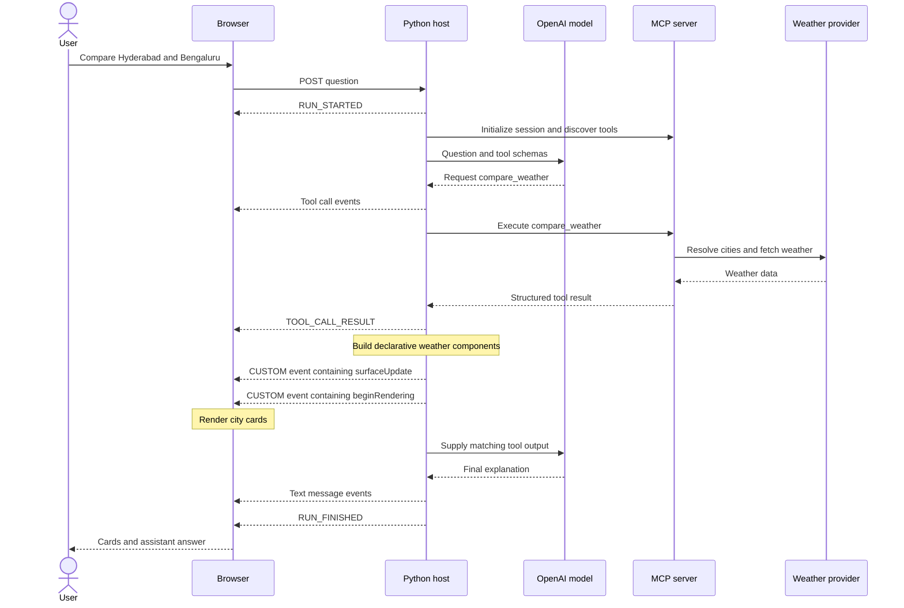

# Building an AI chat UI with A2UI, AG-UI, and Google components

This interview guide explains the concepts behind Weather Studio and connects
those concepts to the actual code. Read it alongside [WEB_UI_GUIDE.md](WEB_UI_GUIDE.md)
for setup and [LLM_MCP_INTERVIEW_GUIDE.md](LLM_MCP_INTERVIEW_GUIDE.md) for the model
and tool-calling loop.

The project implements a **custom A2UI v0.8 subset**, **AG-UI-shaped events over
SSE**, and **Google Material Web controls**. It does not use complete A2UI or
AG-UI SDK integrations. Keep this distinction explicit when describing your work.

All sample temperatures, city results, and identifiers below are illustrative.

## 1. Your 60-second interview answer

> I built a weather assistant that responds with both text and structured UI.
> The Python host sends the question and tool definitions to an OpenAI model.
> When the model selects a weather tool, the host invokes it through MCP.
> The returned weather data is converted into a declarative component tree.
> The host sends tool progress, UI messages, and the final explanation to the
> browser through an SSE stream using an AG-UI event subset. The browser renders
> the A2UI component messages through an allowlisted renderer. Google Material
> Web supplies the Ask and New conversation controls, while custom CSS styles
> the weather cards. The model selects the tool, and application code controls
> the layout, so the model never needs to generate executable frontend code.

If asked about interoperability, add:

> This is a focused prototype. It uses selected A2UI and AG-UI concepts and
> message formats, but the request endpoint and renderer are application-specific.
> A general-purpose client would need an adapter or a fuller protocol integration.

## 2. The different problems each layer solves

| Layer | Question it answers | Project implementation |
| --- | --- | --- |
| LLM | What does the user need, and which tool should be requested? | OpenAI calls in `chat.answer()` |
| MCP | How does the host discover and execute a tool? | `ClientSession` and FastMCP |
| AG-UI-style events | What is happening during the run, and what should the frontend receive next? | Event dictionaries in `web_app.py` |
| SSE | How are events delivered incrementally over HTTP? | `StreamingResponse` and the browser stream reader |
| A2UI | How is a UI described as structured data? | `weather_surface()` and its component messages |
| Renderer | How does a component description become browser elements? | `renderComponent()` in `web/app.js` |
| Material Web | Which reusable controls provide appearance and interaction behavior? | `md-filled-button` and `md-outlined-button` |
| Project CSS | How are layout, weather cards, and responsive styling defined? | `web/style.css` |

A2UI and AG-UI are separate projects. AG-UI is not Google's component library.
Material Web is not an agent protocol. MCP does not render the browser UI.

The general A2UI background is described in the
[A2UI specification](https://a2ui.org/specification/v0.8-a2ui/). AG-UI defines
structured agent/frontend events, described in its
[event documentation](https://docs.ag-ui.com/concepts/events). The table above
maps those ideas to this repository rather than claiming full implementations.

## 3. Architecture you can draw on a whiteboard



The browser sends one chat POST and reads multiple SSE frames from its response.
The host makes the model and MCP calls while that response remains open.
The UI can show weather cards before the final model explanation is ready.

## 4. Why structured UI helps a chat application

A paragraph is useful for explanation. A visual comparison is easier to scan
when the user needs temperatures, humidity, and wind for two cities.
Weather Studio keeps both: cards for factual values and text for interpretation.

The model's tool selection indirectly selects the presentation:

| Returned data shape | Presentation selected by application code |
| --- | --- |
| `temperature_c` | Current-weather card |
| `days` | Daily forecast rows |
| `hours` | Hourly forecast rows |
| `first_city` and `second_city` | Two cards and a temperature difference |
| Error or unrecognized result | No weather surface |

This is template-based, agent-driven presentation. It is not a system where the
LLM invents arbitrary layouts. That choice keeps layout behavior predictable and
lets tests verify the generated structures without relying on model output.

## 5. A2UI: describing a surface with data

A declarative UI says what components exist and how they relate. The client
owns the rendering implementation. In this project, the backend sends component
descriptions, not HTML or JavaScript.

The project deliberately uses the v0.8 wire format. Official documentation labels
that version as legacy, so do not present it as a universal format for every
A2UI version. Check version-specific schemas before building another integration.
See the [versioned A2UI reference](https://a2ui.org/specification/v0.8-a2ui/).

### Surface, component, and root

A **surface** is an identified UI region. Components inside it have IDs. A root
ID tells the renderer where to start building the tree.

Here is a minimal example matching the subset this project understands:

```json
{
  "surfaceUpdate": {
    "surfaceId": "weather-example",
    "components": [
      {
        "id": "city",
        "component": {
          "Text": {
            "text": {"literalString": "Hyderabad"},
            "usageHint": "h2"
          }
        }
      },
      {
        "id": "temperature",
        "component": {
          "Text": {
            "text": {"literalString": "29°C"},
            "usageHint": "h1"
          }
        }
      },
      {
        "id": "details",
        "component": {
          "Column": {"children": {"explicitList": ["city", "temperature"]}}
        }
      },
      {
        "id": "card",
        "component": {"Card": {"child": "details"}}
      }
    ]
  }
}
```

A second message starts rendering:

```json
{
  "beginRendering": {
    "surfaceId": "weather-example",
    "root": "card"
  }
}
```

These are separate messages. The application does not send two JSON objects
concatenated into a single JSON document.

### Why component IDs instead of deeply nested HTML?

The component list is an adjacency-list representation: a container references
its children by ID. The frontend can index components in a map and recursively
resolve relationships. This separates structure from rendering details.

In a broader implementation, identified components can support targeted updates.
Our renderer constructs a fresh surface and does not implement incremental
patching of already-rendered component trees.

### Catalog and data binding: concept versus implementation

A component catalog defines the available component types and their properties.
This project's allowlist functions as a fixed agreement between the backend and
frontend. It supports `Text`, `Row`, `Column`, and `Card`; there is no runtime
catalog negotiation.

Data binding separates displayed components from values in a data model. Here,
all values are embedded as `literalString`. There are no bound paths or
`dataModelUpdate` handlers. Supporting them would require a data store and
reactive update logic in the renderer, not just another CSS class.

## 6. From an MCP result to a weather surface

Read [weather_mcp/ui.py](weather_mcp/ui.py).

`tool_data(result)` first excludes MCP results marked `isError`. It then extracts
a dictionary from `structuredContent`, including a supported `result` wrapper,
or tries to decode JSON text content. An MCP result wrapper and a domain weather
dictionary are different objects, so this extraction step matters.

`weather_surface(data)` builds a component list through small helper functions:

```python
# Simplified from weather_mcp/ui.py
components.append({
    "id": cid,
    "component": {kind: props},
})
```

The helpers create text, rows, columns, metrics, and cards. The function chooses
a layout from the weather keys and returns `surfaceUpdate` followed by
`beginRendering`, sharing one generated surface ID.

Important separation: the MCP tool returns weather facts. The host's UI adapter
turns those facts into presentation data. The weather tool itself does not need
to know whether its caller is a terminal, browser, or another MCP client.

For another domain, replace the weather-to-components adapter. For example,
product search could return comparison cards, while appointment availability
could return a selection form. Actions that create bookings would also need
server-side validation, authorization, and explicit workflow handling.

## 7. AG-UI: representing an agent run as events

An agent request can involve model work, tool calls, returned data, and final
text. A single opaque response gives the browser little visibility into those
stages. Events let the application expose meaningful progress.

Weather Studio emits this subset:

| Event | Meaning in this application |
| --- | --- |
| `RUN_STARTED` | A run has begun with a thread ID and run ID. |
| `TOOL_CALL_START` | The model has selected a named tool. |
| `TOOL_CALL_ARGS` | Supplies the selected tool's JSON argument string. |
| `TOOL_CALL_END` | Tool argument emission has ended. |
| `TOOL_CALL_RESULT` | The MCP result has arrived. |
| `CUSTOM` with name `a2ui` | Carries a UI description message. |
| `TEXT_MESSAGE_START` | Begins an assistant message. |
| `TEXT_MESSAGE_CONTENT` | Supplies answer text. |
| `TEXT_MESSAGE_END` | Ends that assistant message. |
| `RUN_FINISHED` | The run completed successfully. |
| `RUN_ERROR` | The run failed. |

The broader protocol also covers state-related events, but this project does
not implement shared-state synchronization. Consult the
[AG-UI event reference](https://docs.ag-ui.com/concepts/events) for the general
protocol, rather than treating this subset as its full feature set.

A common interview trap is interpreting `TOOL_CALL_END` as “the API request
finished.” In this implementation it closes argument emission. The subsequent
`TOOL_CALL_RESULT` conveys the execution output.

### IDs at different layers

| ID | Purpose |
| --- | --- |
| `threadId` | Identifies the conversation for emitted events. |
| `runId` | Identifies one attempt to answer a question. |
| `toolCallId` | Correlates the selected tool, its arguments, and result. |
| `messageId` | Identifies an event-level message. |
| `surfaceId` | Identifies the declarative UI region. |
| Component `id` | Identifies a node within a surface. |

The MCP SDK also uses protocol request IDs internally. Those are separate from
the model's function-call ID and the UI surface ID.

### The request contract is custom

The frontend sends:

```json
{"message": "Compare weather in Hyderabad and Bengaluru"}
```

`web_app.py` creates run IDs and maintains history using a server-owned session.
It does not accept the complete standard AG-UI run input. No AG-UI SDK is
installed. Describe this as an AG-UI-shaped event integration, not a drop-in
endpoint for any AG-UI client.

## 8. How A2UI travels inside an AG-UI-style event

The backend wraps each UI message in an event envelope:

```json
{
  "type": "CUSTOM",
  "name": "a2ui",
  "value": {
    "beginRendering": {
      "surfaceId": "weather-example",
      "root": "card"
    }
  }
}
```

This is the convention chosen by our host and frontend. The `CUSTOM` event
carries a payload; the `a2ui` handler understands the payload's meaning.
AG-UI-style lifecycle events describe the run, while A2UI messages describe
surface content.

A2UI does not require this exact transport wrapper. Conversely, an agent can
emit useful text and tool events without any A2UI surfaces.

## 9. SSE: transporting events to the browser

In [web_app.py](web_app.py), `send()` places event dictionaries into a bounded
`asyncio.Queue`. `produce()` performs the agent work. `stream()` reads the queue
and yields SSE frames:

```text
data: {"type":"RUN_STARTED","threadId":"thread-example","runId":"run-example"}

data: {"type":"CUSTOM","name":"a2ui","value":{"beginRendering":{"surfaceId":"weather-example","root":"card"}}}

```

Each frame ends with a blank line. The HTTP response uses
`Content-Type: text/event-stream`.

The browser uses `fetch()` with POST, then reads `response.body`. It decodes
bytes with a streaming `TextDecoder`, buffers incomplete data, and parses JSON
after receiving a complete frame. Network chunks do not necessarily align with
events: one event may span several reads, or one read may contain several events.

Native `EventSource` normally opens a GET connection, which is why this POST
endpoint uses a fetch reader instead. The parser supports the framing emitted
by this backend; it is not a general SSE client with reconnection and replay.

### SSE versus WebSocket

SSE fits this application because updates mainly flow from server to browser
while one answer is being produced. User questions and reset actions use normal
POST requests. WebSockets may suit workloads with frequent simultaneous
bidirectional messages, but add a different connection lifecycle and operational
tradeoffs. A choice of transport does not by itself implement an agent protocol.

### Backpressure and cancellation

The queue has `maxsize=32`. When full, an awaited `put()` pauses the producer
until the consumer drains an item. That limits queued events, not the size of
each event or the total model context.

When streaming ends, the host cancels its producer task and exits the active
client and MCP contexts. This helps release local resources. It cannot reverse
completed external requests or their charges. Production systems should also
bound request duration and handle stalled connections deliberately.

### Event streaming versus token streaming

The project streams lifecycle, tool, and surface events. It does not request
streamed OpenAI tokens. Once `answer()` returns, the backend emits the completed
explanation in one `TEXT_MESSAGE_CONTENT` event. Saying “the app streams events”
is accurate; saying “it streams every generated model token” is not.

## 10. Rendering the component description safely

Read `renderComponent()` and `a2ui()` in [web/app.js](web/app.js).

When `surfaceUpdate` arrives, the client stores components in a map keyed by ID.
When `beginRendering` arrives, it starts at the root and resolves child IDs.

| Declarative type | Browser representation in this project |
| --- | --- |
| `Text` | A paragraph with text content and a supported styling hint |
| `Row` | A flex container with row styling |
| `Column` | A flex container with column styling |
| `Card` | A styled container holding its referenced child |

The renderer rejects unsupported component kinds and checks for cycles along
the current traversal path. Its size check limits traversal depth rather than
providing a complete total-node or payload-size budget.

Text is assigned through `textContent` or text nodes. A string containing
`<script>` is displayed as text rather than treated as markup. The renderer does
not evaluate code or accept arbitrary component URLs.

This reduces exposure to executable content but does not make an entire agent
application automatically secure. Payload validation, access controls, resource
limits, and tool authorization remain separate requirements.

## 11. Google components: Material Design and Material Web

**Material Design** supplies design conventions. **Material Web** supplies web
components implementing Material controls. A web component is exposed through a
custom HTML element such as `md-filled-button`; it is not a React component or
an A2UI message. See the [official Material Web repository](https://github.com/material-components/material-web).

The application dynamically imports the pinned Material Web package:

```javascript
await import('https://esm.run/@material/web@2.3.0/all.js');
```

It then replaces native controls with:

```text
md-filled-button     → Ask
md-outlined-button   → New conversation
```

The browser app remains usable if that import fails because native controls
were rendered first. This is progressive enhancement.

### Design tokens and visual consistency

Project CSS sets custom properties such as:

```css
:root {
  --md-sys-color-primary: #36654e;
  --md-sys-color-on-primary: #fff;
  --md-ref-typeface-plain: 'DM Sans', sans-serif;
}
```

These tokens coordinate Material controls with the application's colors and
fonts. Google Fonts supplies DM Sans and Manrope, with fallback fonts if loading
fails. CSS media queries stack content for smaller screens.

The weather cards are custom DOM/CSS components. An A2UI `Card` does not
inherently become a Google Material component in this renderer. A different
renderer could map supported A2UI types to a Material-based component library,
provided it honored the selected catalog's properties and behavior.

Do not confuse this setup with Angular Material or React Material UI. Neither
framework is installed here. The frontend uses browser JavaScript, custom
HTML elements, and CSS.

## 12. Walk through a complete question

For “Compare Hyderabad and Bengaluru” in real mode:

1. `submit()` appends the user's question and disables conflicting controls.
2. The browser POSTs to `/api/chat` and begins reading the response stream.
3. The host checks input, origin, session capacity, API key, and conversation lock.
4. `produce()` emits `RUN_STARTED` and opens a local MCP subprocess and session.
5. Tool discovery builds OpenAI function definitions from MCP metadata.
6. `answer()` asks the model to interpret the question using available tools.
7. The model requests `compare_weather` with city arguments.
8. The optional `emit` callback exposes tool selection to the browser host.
9. The host emits tool-call events and invokes the tool through MCP.
10. The server fetches both cities' weather concurrently and computes the difference.
11. The host emits `TOOL_CALL_RESULT` and passes extracted weather data to `weather_surface()`.
12. Two A2UI messages reach the browser through `CUSTOM` events and render comparison cards.
13. The tool output is also returned to the model through its matching function-call ID.
14. The model writes the explanation, and successful conversation history is committed.
15. The host emits text events and `RUN_FINISHED`; the browser re-enables input.

The optional callback lets the CLI and browser reuse one model loop. The CLI
needs returned text; the browser also observes tool activity.

## 13. How follow-up buttons work

After rendering a surface, `a2ui()` finds the city names in title components and
adds follow-up buttons. Clicking “5-day outlook” sends a new natural-language
prompt through the same `/api/chat` path.

Those buttons are frontend additions. They are not declarative A2UI buttons,
and the application does not send A2UI `userAction` messages. Extracting city
names from title text is a prototype shortcut. A stronger design would provide
explicit domain IDs and validated action metadata instead of relying on visual
heading content.

For a production action such as buying or booking, do not rely solely on an LLM
reinterpreting a button label. Use a defined action contract, validate inputs,
authorize the operation, and make retries safe where appropriate.

## 14. State, failures, and user experience

The server holds conversation history in memory behind an opaque HttpOnly
cookie. Sessions are bounded and idle sessions are cleaned up when subsequent
requests obtain a session. A lock allows one active question per conversation.
This prevents competing turns from writing the same history concurrently.

The browser tracks the current turn, current answer, pending surfaces, and busy
state. Browser UI state and server model history are related but different.
They are not synchronized through AG-UI state-delta events in this version.

Errors before streaming begins use normal HTTP error responses. Errors during
an active run use `RUN_ERROR`. If cards have already arrived and the final model
request fails, the cards remain visible and the page shows an error. Model
history is not committed for that failed turn. A successful history commit is
not guaranteed to mean the browser received the final text before disconnecting.

The interface uses clear progress text, a labeled demo mode, keyboard support,
focus styles, reduced-motion rules, and responsive layouts. These are deliberate
application choices. Protocol adoption alone does not provide good accessibility
or an intuitive interaction design.

## 15. How to build a similar application from scratch

1. **Define domain tools and data contracts.** Decide which operations are allowed and what their results contain.
2. **Choose the model-to-tool integration.** MCP is useful for reusable tool discovery and execution, but is not required by a browser UI protocol.
3. **Choose a versioned UI contract.** Define supported component types and validation rules before allowing generated layouts.
4. **Build the domain-to-UI adapter.** Start with templates driven by validated data; introduce model-selected layouts only if they help the task.
5. **Define the run event contract.** Include lifecycle, tool, text, UI payload, and failure behavior.
6. **Implement the transport.** Choose SSE or another suitable channel and handle framing, disconnects, and resource limits.
7. **Build the renderer.** Map allowlisted component types to trusted controls and accessible markup.
8. **Apply a design system.** Use consistent spacing, tokens, typography, states, and responsive behavior.
9. **Handle actions and conversation state.** Define ownership, authorization, retries, and persistence requirements.
10. **Test the boundaries.** Cover schemas, event order, invalid payloads, session isolation, browser rendering, and external-service failures.

For broad interoperability, use the relevant SDKs and versioned schemas and test
against another implementation. Similar event names alone do not establish
protocol compliance.

## 16. Interview questions and sample answers

### What is the difference between A2UI and AG-UI?

A2UI describes presentation as structured component data. AG-UI describes events
between agent execution and the frontend. Our application carries A2UI messages
inside custom AG-UI-shaped events, while SSE transports those events.

### Does A2UI replace React, Angular, or Material Web?

No. A client still needs a renderer and concrete controls. This project uses
plain DOM APIs and Material Web for selected controls. Another client could use
a framework, provided its renderer supports the agreed UI contract.

### Is every A2UI interface generated by an LLM?

No. In this project deterministic Python functions create UI messages from tool
results. The model chooses the requested information. Model-generated layouts
would be an additional feature requiring schema and catalog validation.

### Why not ask the model to return HTML?

A constrained component contract lets the application control available widgets,
render text safely, and test layout structures. Arbitrary HTML would require a
different trust model, sanitization strategy, and styling constraints. Neither
approach removes the need to validate domain actions.

### Are MCP and AG-UI alternatives?

They address different boundaries. MCP connects the host to tools; the AG-UI
integration connects the host's run events to the frontend. They can coexist.

### Can I use AG-UI without A2UI?

Yes. An application can show text, progress, and tool status without declarative
surfaces. Likewise, a declarative surface can be delivered through a different
application transport.

### What makes your UI agent-driven if the layout is a template?

The model selects tools and arguments from the user's intent. The resulting
data selects the current-weather, forecast, or comparison presentation. Layout
construction remains controlled by the application.

### Does your application support token streaming?

Not currently. It streams run and tool events and renders surfaces before the
final explanation, but sends the explanation after the buffered model call
returns. Token streaming would require consuming model deltas and translating
them into message-content events.

### How do you prevent cross-site scripting?

The renderer allows four component kinds and assigns text through safe DOM
text APIs rather than generated HTML. It does not evaluate scripts. I would
still add stronger payload schemas and content/resource limits for an untrusted
remote producer.

### Why choose Material Web?

It supplies reusable controls that work with browser JavaScript without adding a
frontend framework to this small Python project. Theme tokens help match those
controls to the rest of the interface. Native controls remain as a fallback.

### Is this fully compliant with A2UI and AG-UI?

No. It is an explicitly documented subset with a custom request endpoint and
custom renderer. It omits catalog negotiation, data binding, A2UI user actions,
and AG-UI state synchronization. That is a scope decision, not equivalent to
passing a protocol conformance suite.

### How would you scale it?

Move session state out of process, add authenticated user ownership and rate
limits, define context budgets, and measure model/tool latency. Choose a managed
MCP connection lifecycle rather than assuming a subprocess per request will fit
all workloads. Add event persistence and reconnection only if the product needs
them. The current design is a single-worker loopback application.

### How would you support a new chart component?

Choose or extend the catalog, define a validated chart-data schema, add the
backend adapter and frontend renderer, and test missing/large/invalid data. Do
not accept arbitrary chart JavaScript from the model. Check compatibility with
the protocol version before claiming interoperability.

### What tests demonstrate that the integration works?

Unit tests verify component references and tool-result extraction. HTTP tests
verify SSE lifecycle, demo labeling, input validation, missing-key behavior,
session isolation, and assets. Model-loop tests use mocks. Chrome checks have
also exercised demo cards, comparisons, forecast follow-ups, Material loading,
and mobile overflow. These checks do not establish live model accuracy.

## 17. Claims to phrase precisely in an interview

| Avoid claiming | Describe the implementation this way |
| --- | --- |
| “The LLM creates all frontend code.” | “The model chooses tools, and Python builds declarative UI templates.” |
| “We integrated the full AG-UI SDK.” | “We emit an AG-UI event subset through a custom SSE endpoint.” |
| “All A2UI features are supported.” | “We render four component kinds using selected v0.8 message shapes.” |
| “The weather cards are Google components.” | “Material Web supplies selected controls; weather cards use project CSS.” |
| “Every token streams immediately.” | “Progress and UI events stream; final model text is buffered.” |
| “SSE handles reconnect automatically.” | “Our fetch-based consumer parses frames without replay or reconnection.” |
| “A protocol makes the app secure.” | “We also need validation, authorization, resource controls, and safe rendering.” |

## 18. Files to open during a project demonstration

| File | What to explain |
| --- | --- |
| [chat.py](chat.py) | Shared model loop and optional event callback |
| [server.py](server.py) | Registered MCP tools |
| [weather_mcp/ui.py](weather_mcp/ui.py) | Weather-result extraction and A2UI message construction |
| [web_app.py](web_app.py) | Sessions, event bridge, SSE producer/consumer, and lifecycle |
| [web/app.js](web/app.js) | SSE parser, event dispatcher, allowlisted renderer, and actions |
| [web/style.css](web/style.css) | Theme tokens, weather layouts, focus styles, and mobile rules |
| [web/index.html](web/index.html) | Accessible application shell and native fallback controls |
| [tests/test_web.py](tests/test_web.py) | UI contract and HTTP behavior checks |

## 19. A short practice exercise

Explain how you would add an air-quality response without changing the existing
weather tool contracts. A strong answer should cover a new tool and result
schema, model discovery, a validated UI adapter, a supported component mapping,
source and timestamp display, failure behavior, and tests. Then explain which
parts can reuse the existing event transport and which require new domain logic.

Use that exercise to show that you understand the boundaries, rather than only
remembering the library names.

## References and further reading

- [A2UI v0.8 specification](https://a2ui.org/specification/v0.8-a2ui/) — the version targeted by this prototype.
- [AG-UI event documentation](https://docs.ag-ui.com/concepts/events) — broader event concepts beyond our subset.
- [Google Material Web repository](https://github.com/material-components/material-web) — the controls used for progressive enhancement.
- [Local UI setup and implementation limits](WEB_UI_GUIDE.md).
- [Model and MCP interview walkthrough](LLM_MCP_INTERVIEW_GUIDE.md).

The protocol references explain their respective projects. Code walkthroughs,
design decisions, examples, and limitations in this document describe this
repository's implementation.
